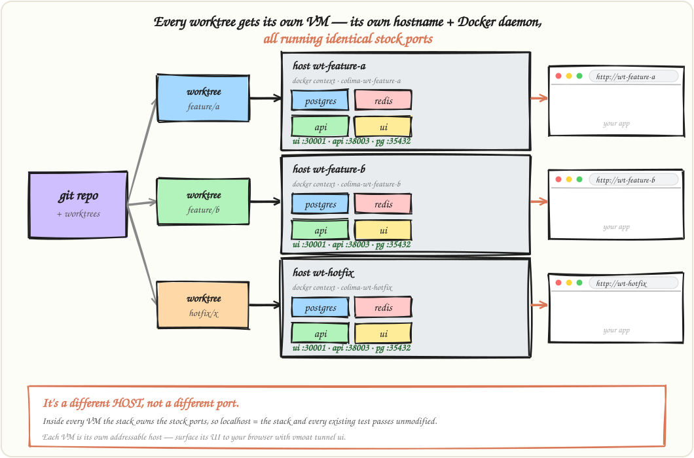
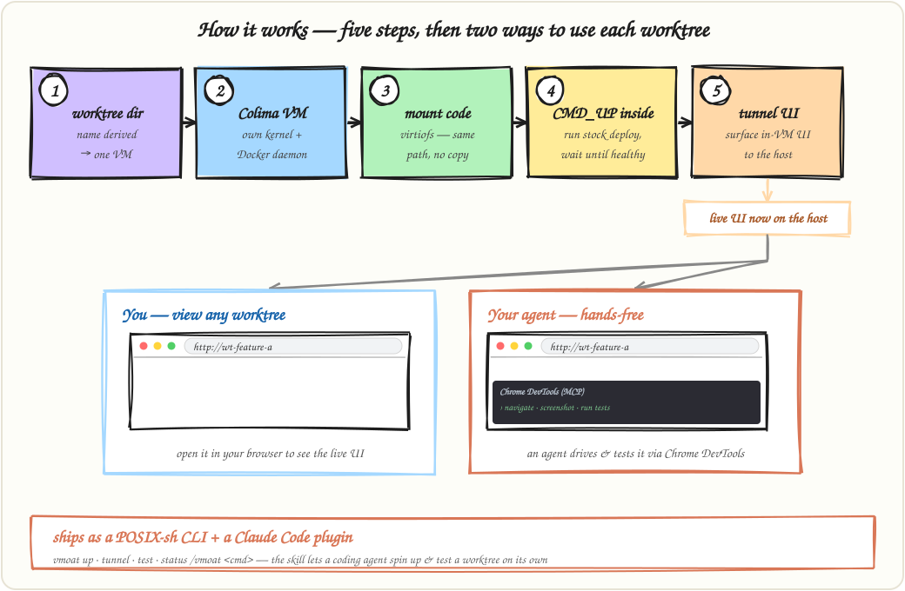

# vmoat
[](https://code.claude.com/docs/en/plugins)
[](./bin/vmoat)
[](#requirements)
[](https://github.com/abiosoft/colima)
[](./LICENSE)
[](./.claude-plugin/plugin.json)

## A moat around every git worktree.

One ephemeral [Colima](https://github.com/abiosoft/colima) VM per worktree, so you can build and test several worktrees of the same project **in parallel**, each in its own Linux kernel and Docker daemon. A `docker system prune`, an OOM or a crashed stack in one worktree can't touch another worktree or your host.

**Memory comes back.** Stock Colima and Lima VMs on macOS never give memory back while they run: a VM holds every GB it has ever touched until you stop it. With vmoat's memory reclaim (`vmoat up --reclaim`, experimental), freed memory goes back to macOS within about 30 seconds, while the VM keeps running. See [Memory on macOS](#memory-on-macos).

Inside the VM you run your project's **stock** commands (`./deploy.sh local`, `make up`, `docker compose up`) with default ports, so existing tests pass unmodified: `localhost` *is* the stack. vmoat ships as a POSIX-sh CLI and a Claude Code plugin (a skill plus a `/vmoat` command), so an agent can bring up and test a worktree on its own. Everything repo-specific lives in an optional `vmoat.conf`.

<p align="center">
  
</p>

**Why vmoat**

- **Isolation:** separate kernel and Docker daemon per worktree, no shared blast radius.
- **Stock commands and ports:** your tests run unmodified.
- **Memory release:** freed guest RAM returns to macOS while the VM runs (opt-in, experimental).
- **Instant VMs from a base image:** `vmoat base save` snapshots a built VM; every new worktree's VM is a copy-on-write clone of it, ready in about 15 s instead of a 10-20 min first build, sharing disk blocks with the base (macOS).
- **Agent-ready:** a Claude Code plugin drives bring-up, tests and browser checks.
- **Boot watchdog:** every VM gets a guard for a systemd 255 bug in Ubuntu 24.04 (the image Colima uses), where Lima's boot can leave `systemd-logind` spinning at 100% CPU and make each SSH login wait about 120 s. A guest timer detects this and restarts logind within about a minute. Applies on a VM's next `vmoat up`.

## Requirements

- macOS (Apple Silicon recommended), Linux, or Windows + WSL2 (nested virtualization on).
- [`colima`](https://github.com/abiosoft/colima) and a `docker` CLI.
- Enough RAM for the stacks you run at once (see [Memory on macOS](#memory-on-macos)).

The backend is auto-detected: macOS 13+ uses `vz` + `virtiofs`, older macOS `qemu` + `sshfs`, Linux/WSL2 Colima's `qemu` + KVM. Override with `VM_TYPE` / `MOUNT_TYPE`. A VM keeps the backend it was created with; vmoat warns if it isn't the preferred one.

## Install

**Homebrew** (installs vmoat and Colima; you still need a `docker` CLI):

```sh
brew install voycey/vmoat/vmoat
```

**From source:**

```sh
git clone https://github.com/voycey/vmoat ~/.vmoat
ln -s ~/.vmoat/bin/vmoat /usr/local/bin/vmoat   # or ~/.local/bin
```

On Linux install Colima yourself (`brew install colima docker` works). On WSL2, install it inside the distro, keep worktrees on the Linux filesystem (not `/mnt/c`), and set this in `%UserProfile%\.wslconfig`:

```ini
[wsl2]
nestedVirtualization=true
```

**Claude Code plugin:**

```text
/plugin marketplace add voycey/vmoat
/plugin install vmoat@vmoat
```

For a quick test without installing: `claude --plugin-dir ~/.vmoat`. Once enabled, `bin/` is on `$PATH`, the skill triggers when you ask Claude to build or test a worktree in isolation, and `/vmoat <cmd>` works.

## Quickstart

With the plugin installed, just ask Claude to verify a branch ("verify this worktree end-to-end", "check the UI in the browser"). The skill brings the worktree up in its own VM, runs the tests there, tunnels the app to your host and drives Chrome DevTools (MCP) against it. It writes a `vmoat.conf` if one is needed.

Or by hand, from any worktree (no config needed for a standard project):

```sh
vmoat up            # create the VM and start the stack
vmoat tunnel        # forward the stack's ports to the host (prints each URL)
vmoat test --quick  # run CMD_TEST --quick inside the VM
vmoat status        # VM status, containers, health, tunnels
vmoat down          # stop the VM (keeps disk)
vmoat destroy       # delete the VM
```

## Why a VM per worktree

Namespaced stacks on one Docker daemon work until one worktree prunes, runs `down --volumes` or eats the RAM, and every stack dies with it. Separate VMs mean separate daemons and no shared blast radius. Each VM is also its own host, so every stack uses the default ports.

<p align="center">
  
</p>

## How it works

<p align="center">
  
</p>

The VM name comes from the worktree dir (`vmoat name`), one `colima -p <name>` profile each with its own Docker context. Colima mounts `VM_MOUNT` writable at the same path, so there's no copy or sync. Commands run inside the VM via `colima ssh`. `vmoat tunnel` SSH-forwards in-VM ports to your host.

## Configure (optional)

vmoat needs no config for a standard project. It detects the start command (a compose file runs `docker compose up -d`, a Makefile `up:` target runs `make up`, a `package.json` `dev` script runs `npm run dev`) and discovers ports to tunnel from the running containers. Add a `vmoat.conf` (or run `vmoat init`) to customize. It is shell-sourced (`KEY="value"`) and trusted project code.

| Key | Meaning |
|---|---|
| `CMD_UP` | Command run inside the VM to start the stack (auto-detected for standard layouts) |
| `CMD_TEST` | Command for `vmoat test` (args appended) |
| `VM_CPU` / `VM_MEMORY` / `VM_DISK` | VM size (defaults 4 / 8 GiB / 60 GiB). RAM limits how many VMs you can run |
| `VM_MOUNT` | Host path mounted writable into the VM; must contain the worktree (default `$HOME`) |
| `PROVISION_APT` | Extra apt packages |
| `PROVISION_SCRIPT` | Shell to install anything apt can't |
| `PROVISION_SEED` | Gitignored files copied from the main checkout into a fresh worktree |
| `HEALTH_URL` / `HEALTH_TIMEOUT` | If set, `up` waits until this URL returns 2xx inside the VM |
| `EXPOSE_PORTS` | Guest ports `tunnel` forwards (bash array or space-separated string) |
| `VM_TYPE` / `MOUNT_TYPE` | Force a Colima backend |
| `HOST_RESERVE` | GiB of host RAM kept free of VMs in the `up` budget check (default: 1/8 of host RAM, at least 8) |
| `REAP_IDLE_MIN` / `REAP_LOAD` | `reap` stops a VM idle this many minutes (default 60) with guest 5-min load under this (default 1.0) |
| `MEMORY_RECLAIM` | `1` creates new VMs on the experimental reclaiming backend (same as `up --reclaim`); `auto` only where it's available (same as `up --reclaim=auto`; [below](#experimental-memory-reclaim-krunkit)) |
| `RECLAIM_INTERVAL` | Minutes between guest page-cache drops on reclaim VMs (default 5) |
| `BASE_IMAGE` | Base image new VMs clone from (default: the main checkout's directory name) |
| `AUTO_BASE` | `1` (default) saves a repo's first from-scratch VM as its base image; `0` to skip |
| `BASE_KEEP_VOLUMES` | `1` keeps Docker volumes (e.g. a seeded database) when saving a base image |
| `KRUNKIT_HOME` | Optional. Where the reclaiming runtime is installed (default `~/.local/share/vmoat/krunkit`) |

**Per-worktree overrides.** `vmoat.conf` is committed and shared. When one worktree needs different settings (say an extra debug port or more RAM), put them in a gitignored `vmoat.local.conf` in that worktree. It is sourced after `vmoat.conf`, so it wins. Add it to your `.gitignore`.

```sh
# vmoat.local.conf
EXPOSE_PORTS=(30001 38003 9229)
VM_MEMORY=24
```

## Commands

| Command | Does |
|---|---|
| `init` | Scaffold a `vmoat.conf` |
| `up [--reclaim[=auto]] [--fresh]` | `provision`, then run `CMD_UP` in the VM (and wait for `HEALTH_URL` if set). A new VM clones the base image if one exists; `--fresh` builds from scratch |
| `base save [name]` / `base ls` / `base rm <name>` | Snapshot this worktree's VM as a base image / list / delete them |
| `test [args]` | Run `CMD_TEST [args]` in the VM |
| `tunnel [port...]` | Forward in-VM ports to free host ports (default: `EXPOSE_PORTS`, else auto-discovered) |
| `untunnel` | Close this worktree's tunnels |
| `provision` | Create/start the VM, install the toolchain, seed files |
| `status` | VM status, containers, health, tunnels |
| `ls` | Every vmoat VM on the host, with the RAM each running one holds |
| `reap [--idle MIN] [--dry-run]` | Stop every VM nobody is using; `--install-agent` writes a launchd job (every 10 min) |
| `ssh [cmd]` | Shell into the VM, or run a command in the worktree dir |
| `down [vm]` | Stop the VM (keeps disk, frees RAM); `down <vm>` stops any VM by its `ls` name |
| `destroy [-f]` | Delete the VM and its Docker data disk |
| `name` | Print this worktree's VM name |

## Base images: new VMs in seconds (macOS)

The first `up` in a worktree normally builds every image from scratch, 10-20 minutes for a heavy stack. vmoat now does that once per repo: after the first from-scratch `up` it saves the VM as the repo's base image by itself (about a minute, one VM restart; `AUTO_BASE=0` turns it off). `vmoat base save` refreshes it by hand.

From then on, `vmoat up` in a new worktree clones the base instead of building: the clone takes under a second and the VM is ready in about 15 s with the toolchain, images and build cache in place. `CMD_UP` then only rebuilds what the branch changed. Clones are APFS copy-on-write, so they share disk blocks with the base until they diverge, rather than each VM holding its own 60-120 GB copy of the images.

The base keeps images and build cache but drops the source worktree's containers and volumes (set `BASE_KEEP_VOLUMES=1` to keep, say, a seeded database). Re-run `vmoat base save` whenever the images drift; VMs already cloned are unaffected. `vmoat up --fresh` skips the base. Standard and reclaim VMs keep separate bases (`<repo>` and `<repo>-reclaim`). Clones keep the base's disk size and mount, so a worktree that needs a different `VM_MOUNT` or a bigger disk should use `--fresh`.

## Memory on macOS

A running `vz` VM holds host RAM until it is stopped. Guest RAM is allocated lazily, but the host pays for the most RAM the guest has ever touched, and Linux fills spare RAM with page cache. Apple's `vz` never gives that back (three running 16–24 GB VMs here held 59 of their 64 GB while their guests used 6–14 GB). So **RAM, not a fixed count, decides how many VMs you can run**; plan on each costing its `VM_MEMORY`.

- **`vmoat ls`** shows each VM and the host RAM it holds now.
- **`vmoat up`** compares the `VM_MEMORY` of everything running against host RAM minus `HOST_RESERVE` and warns if you'd overcommit. It doesn't refuse: macOS compresses and swaps cold pages, so overcommit is slow, not fatal.
- **`vmoat down`** is suspend: it frees all the VM's host RAM and keeps disk, images and volumes. `vmoat up` reboots it in under a minute and re-runs `CMD_UP`. Containers restart, not resume. `vmoat down <vm>` works from any directory.
- **`vmoat reap`** stops VMs nobody is using. A VM is stopped only if all four hold: no vmoat command has touched it for `REAP_IDLE_MIN` minutes, no `ssh`/`test`/`up` is attached, no tunnel has an open connection, and its guest 5-min load is under `REAP_LOAD`. `--dry-run` shows each verdict. To run it every 10 minutes:
  ```sh
  vmoat reap --install-agent
  launchctl bootstrap gui/$(id -u) ~/Library/LaunchAgents/dev.vmoat.reap.plist
  ```
  Idleness is measured from the last vmoat command, so enable the agent only once every vmoat copy in use (the plugin included) is 0.2.0 or newer.
- **Sizing:** on a 128 GB Mac with the default 16 GB reserve, about 4 VMs at 24 GB, 7 at 16 GB, 9 at 12 GB. Keep a lean default in `vmoat.conf` and raise it for the heavy worktree in `vmoat.local.conf`.

The Claude Code skill runs `vmoat down` when verification finishes. vmoat never enables nested virtualization.

### Experimental: memory reclaim (krunkit)

Stock Colima and Lima VMs on macOS never give memory back while they run. With reclaim, freed memory goes back to macOS within about 30 seconds. Turn it on with `vmoat up --reclaim`, or `MEMORY_RECLAIM=1` in `vmoat.conf` / `vmoat.local.conf`. It applies when a VM is created; to convert one, `vmoat destroy && vmoat up --reclaim`. The default stays standard Colima on `vz` + `virtiofs`; reclaim VMs use Colima's `krunkit` backend with `virtiofs`.

A guest timer also drops Linux page cache every `RECLAIM_INTERVAL` minutes (default 5), so cached memory is freed and returned too. `vmoat ls` reports a reclaim VM's actual host RAM.

Measured through vmoat on an M5 Max (128 GB):
- A guest wrote 5 GB then deleted it: host memory went from 6.3 GB to 1.3 GB within 30 s. The standard backend stays at 6.3 GB until the VM stops.
- After a 7.6 GB page-cache fill, the timer brought it back to 1.4 GB within 90 s.
- A reclaim VM is created or restarted in about 14 s. virtiofs mounts and Docker work.

**One-time setup:** `scripts/build-krunkit.sh` compiles the reclaiming VM runtime (a patched libkrun + krunkit) from source. It takes about 25 s once Rust is installed (needs `cargo`) and installs to `~/.local/share/vmoat/krunkit` (override with `KRUNKIT_HOME`).

**Caveats:** Apple Silicon and macOS 14+ only (elsewhere `MEMORY_RECLAIM=1` is ignored with a warning). Experimental. No Rosetta: amd64 images run under QEMU emulation. Dropping page cache means files get re-read, so raise `RECLAIM_INTERVAL` (15–30) for database-heavy stacks.

## Caveats

- Without a base image, the first `up` per VM is slow (about 10-20 min): images build with no cache shared between VMs, and each VM holds its own copy. See [Base images](#base-images-new-vms-in-seconds-macos).
- RAM caps how many VMs run at once; see [Memory on macOS](#memory-on-macos).
- On WSL2, nested virtualization must be enabled or `colima start` can't boot the VM.
- Some stacks abort the first `up` on a fresh DB volume (a `depends_on: service_healthy` catching `initdb` mid-restart). Re-run `up`.

## Publishing your own plugin

This repo is also a Claude Code marketplace (`.claude-plugin/marketplace.json`). See [`packaging/README.md`](./packaging/README.md) for how vmoat itself is released; for plugin distribution, validate with `claude plugin validate .`, push to GitHub, and users run `/plugin marketplace add <owner>/<repo>`.

## License

[MIT](./LICENSE) © Dan Voyce
