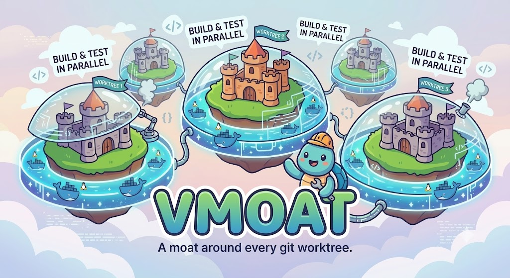

# vmoat
[](https://code.claude.com/docs/en/plugins)
[](./bin/vmoat)
[](#requirements)
[](https://github.com/abiosoft/colima)
[](./LICENSE)
[](./.claude-plugin/plugin.json)

## A moat around every git worktree.

vmoat gives each git worktree its own short-lived [Colima](https://github.com/abiosoft/colima) VM. You can build and test several worktrees of one project **in parallel**, each with its own Linux kernel and Docker daemon. A `docker system prune`, an out-of-memory crash or a broken stack in one worktree can't affect another worktree or your host.

Inside the VM you run your project's normal commands (`./deploy.sh local`, `make up`, `docker compose up`) on the default ports, so existing tests pass unmodified. vmoat is a POSIX-sh CLI and a Claude Code plugin, so an agent can bring up and test a worktree on its own.

<p align="center">
  
</p>

## Why vmoat

- **Isolation:** a separate kernel and Docker daemon per worktree.
- **Stock commands and ports:** your tests run unmodified.
- **Fast new VMs:** clone a saved base image in about 15 s instead of a 10-20 min first build (macOS). See [Base images](docs/base-images.md).
- **Memory returns to macOS:** opt-in and experimental. See [Memory](docs/memory.md).
- **Agent-ready:** a Claude Code plugin drives bring-up, tests and browser checks.

## Requirements

- macOS (Apple Silicon recommended), Linux, or Windows with WSL2 (nested virtualization on).
- [`colima`](https://github.com/abiosoft/colima) and a `docker` CLI.
- Enough RAM for the stacks you run at once. See [Memory](docs/memory.md).

## Install

**Homebrew** (installs vmoat and Colima; you still need a `docker` CLI):

```sh
brew install voycey/vmoat/vmoat
```

**From source:**

```sh
git clone https://github.com/voycey/vmoat ~/.vmoat
ln -s ~/.vmoat/bin/vmoat /usr/local/bin/vmoat   # or ~/.local/bin
```

**Linux:** install Colima yourself (`brew install colima docker` works).

**WSL2:** install Colima inside the distro and keep worktrees on the Linux filesystem (not `/mnt/c`). Enable nested virtualization in `%UserProfile%\.wslconfig`:

```ini
[wsl2]
nestedVirtualization=true
```

**Claude Code plugin:**

```text
/plugin marketplace add voycey/vmoat
/plugin install vmoat@vmoat
```

More in [Claude Code plugin](docs/claude-plugin.md).

## Quickstart

From any worktree (a standard project needs no config):

```sh
vmoat up            # create the VM and start the stack
vmoat tunnel        # forward the stack's ports to the host (prints each URL)
vmoat test --quick  # run CMD_TEST --quick inside the VM
vmoat status        # VM status, containers, health, tunnels
vmoat down          # stop the VM (keeps disk)
vmoat destroy       # delete the VM
```

With the plugin installed, you can instead ask Claude to "verify this worktree end-to-end".

## Configuration

Config is optional. vmoat detects your start command (compose file, Makefile `up:` target, or `package.json` `dev` script) and the ports to tunnel. To customize, add a `vmoat.conf` (or run `vmoat init`):

```sh
CMD_UP="docker compose up -d --wait"
CMD_TEST="docker compose exec -T app pytest"
VM_MEMORY=8
HEALTH_URL="http://127.0.0.1:8080/health"
EXPOSE_PORTS=(8080)
```

See [Configuration](docs/configuration.md) for every key and per-worktree overrides.

## Documentation

- [Commands](docs/commands.md): full CLI reference.
- [Configuration](docs/configuration.md): all `vmoat.conf` keys, overrides, backends.
- [How it works](docs/how-it-works.md): architecture, boot watchdog, known issues.
- [Base images](docs/base-images.md): new VMs in seconds.
- [Memory](docs/memory.md): RAM budgeting, `reap`, and experimental memory reclaim.
- [Claude Code plugin](docs/claude-plugin.md): install, usage and publishing.
- [Releasing](packaging/README.md): how vmoat itself is released.

## License

[MIT](./LICENSE) © Dan Voyce
