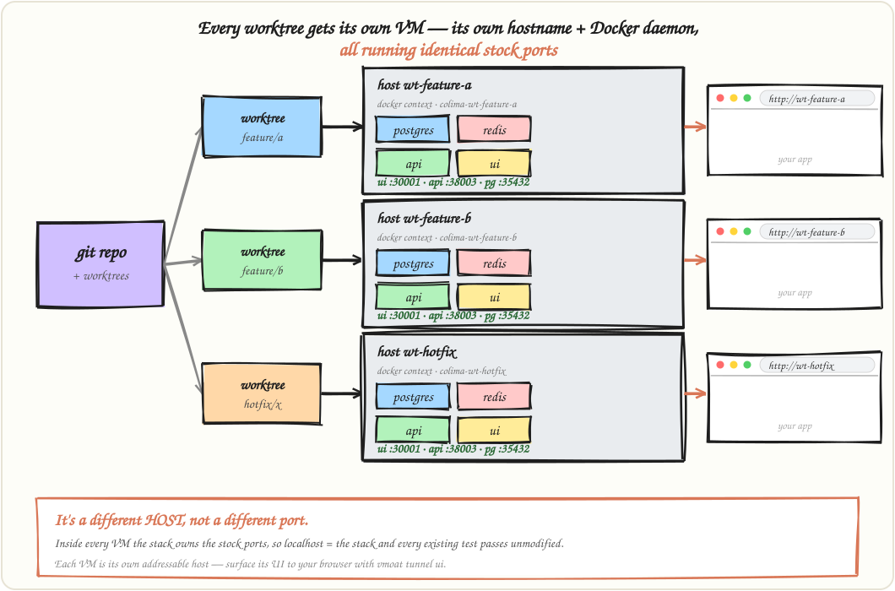
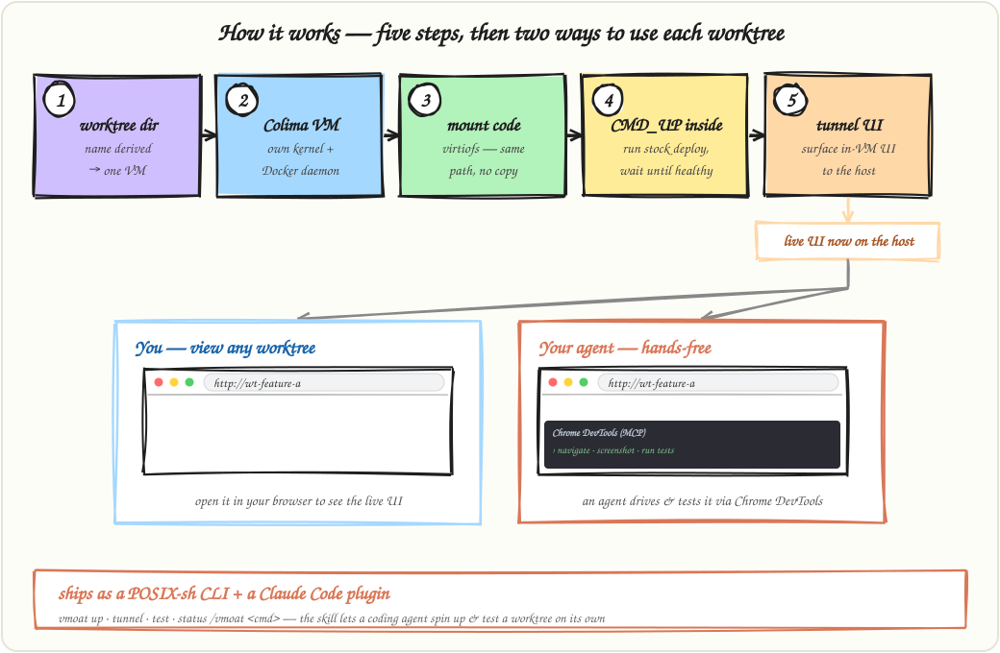

# How it works

## Why a VM per worktree

Namespaced stacks on one Docker daemon work until one worktree prunes, runs `down --volumes` or eats the RAM, and every stack dies with it. Separate VMs mean separate daemons and no shared blast radius. Each VM is also its own host, so every stack uses the default ports.

  

## Lifecycle

  

- The VM name comes from the worktree directory (`vmoat name`). Each VM is one `colima -p <name>` profile with its own Docker context.
- Colima mounts `VM_MOUNT` writable at the same path, so there is no copy or sync.
- Commands run inside the VM via `colima ssh`.
- `vmoat tunnel` SSH-forwards in-VM ports to your host.

## Boot watchdog

Every VM gets a guard for a systemd 255 bug in Ubuntu 24.04 (the image Colima uses). Lima's boot can leave `systemd-logind` spinning at 100% CPU, making each SSH login wait about 120 s. A guest timer detects this and restarts logind within about a minute. It applies on a VM's next `vmoat up`.

## Known issues

- Without a base image, the first `up` per VM is slow (about 10-20 min). Images build with no cache shared between VMs, and each VM holds its own copy. See [Base images](base-images.md).
- RAM caps how many VMs run at once. See [Memory](memory.md).
- On WSL2, nested virtualization must be enabled or `colima start` can't boot the VM.
- Some stacks abort the first `up` on a fresh DB volume (a `depends_on: service_healthy` catching `initdb` mid-restart). Re-run `up`.
